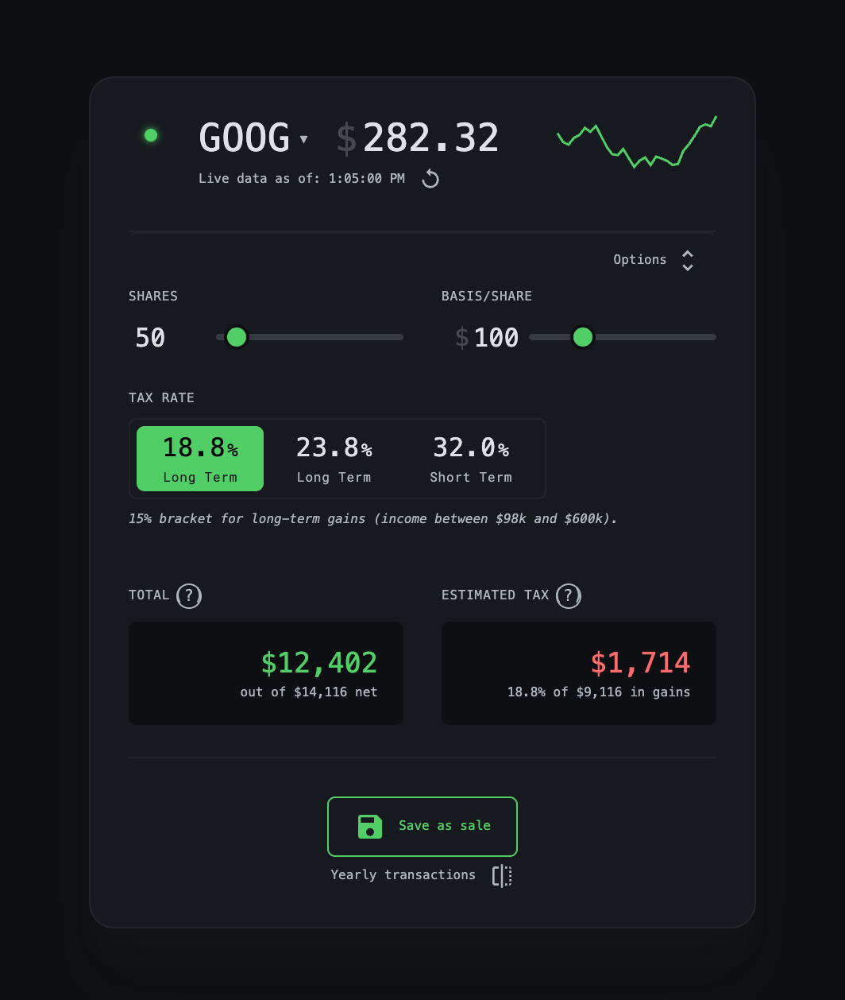
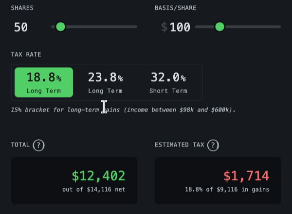
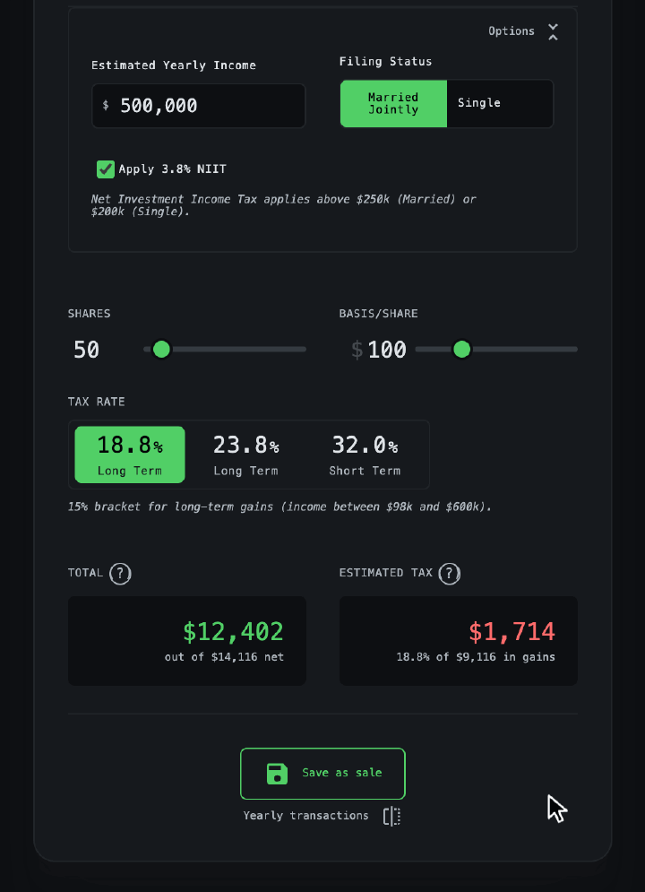
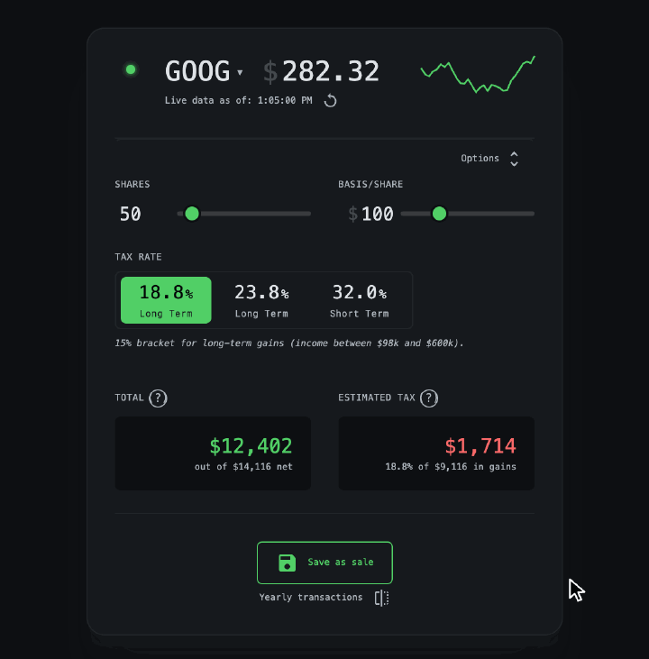
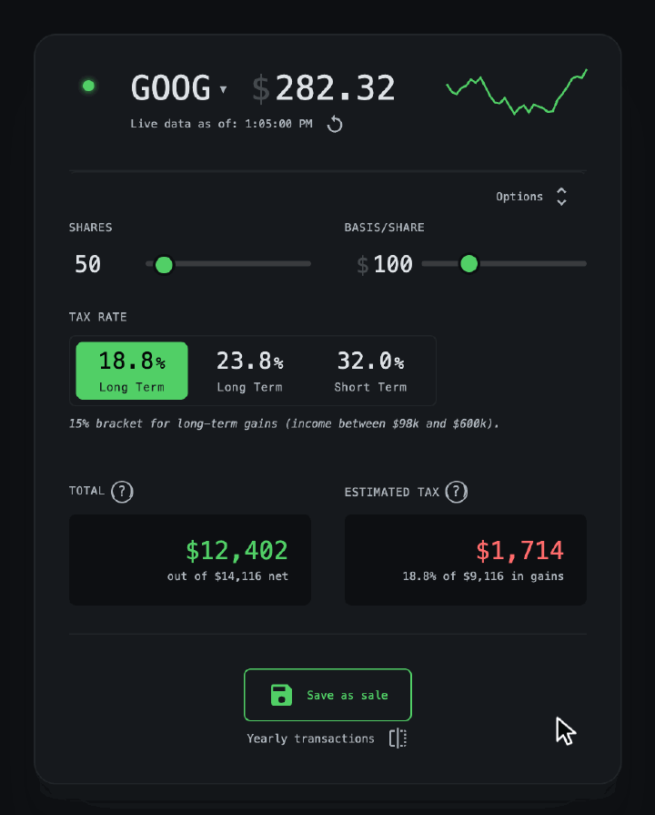

# `calc`

A capital gains calculator for one stock sale. Pick a ticker, slide your shares and cost basis, and see the tax and what you keep at once.

  
[<kbd> haaans.com/calc  </kbd>](https://haaans.com/calc)

## Features

<table>
<tr valign="top">
<td width="50%">
<h3>Drag shares and basis</h3>

Slide how many shares you sell and what you paid for them. The total you keep and the estimated tax follow every step.

</td>
<td width="50%">

</td>
</tr>
<tr valign="top">
<td width="50%">

</td>
<td width="50%">
<h3>Set your income, the rate follows</h3>

Scrub your yearly income or switch filing status under Options. The right long-term bracket and the 3.8% NIIT are picked for you.

</td>
</tr>
<tr valign="top">
<td width="50%">
<h3>Sell at an earlier day's price</h3>

Scrub the sparkline through the last month and click a day: its close becomes the sale price. The ✕ takes you back to live.

</td>
<td width="50%">

</td>
</tr>
<tr valign="top">
<td width="50%">

</td>
<td width="50%">
<h3>Save sales, see your headroom</h3>

Save a sale and the card flips to the year's sales with running totals, and how much more you can sell before the next bracket.

</td>
</tr>
</table>
